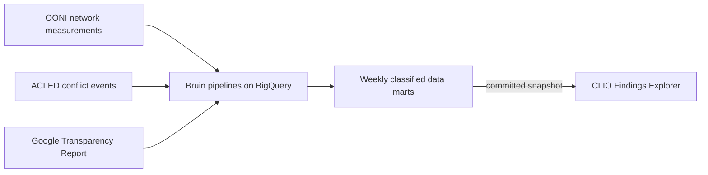

# Samwel Njogu Mwaniki

Data engineer in Nairobi. I build data platforms for civil-liberties research, and the checks that make their numbers trustworthy.

## What I'm working on

**[CLIO](https://github.com/Sanjomwa/Civil-Liberties-Intelligence-Observatory)** (Civil Liberties Intelligence Observatory) is a method for turning heterogeneous information-control signals into validated, uncertainty-stated evidence. It is piloted in Kenya and built to extend to other countries. It joins network-interference measurements, conflict events and platform transparency data into governed data marts, and classifies every week into a pressure regime.

Start here: the [CLIO live dashboard](https://civil-lliberties-intelligence-observatory-toafjdj5xoc.streamlit.app/) and the [CLIO Findings Explorer](https://cfe-frontend-prod-qf6bvfuxjq-ew.a.run.app).

## Selected work

| Project | What it shows |
|---|---|
| [CLIO Findings Explorer](https://github.com/Sanjomwa/clio-findings-explorer) · [live](https://cfe-frontend-prod-qf6bvfuxjq-ew.a.run.app) | Five Kenya findings, each one classified week with its evidence and a limitations box. 671 tests, including one that recomputes all 2,029 numbers on the evidence cards from the raw snapshot. Cloud Run and Neon, auto-deploy to dev, manual promotion to production, OpenTelemetry and an on-call agent with usage caps and a kill switch. |
| [CLIO](https://github.com/Sanjomwa/Civil-Liberties-Intelligence-Observatory) | The platform itself: ingestion, SQL data marts and the weekly regime classification. |
| [Civil Liberties Knowledge Assistant](https://github.com/Sanjomwa/Civil-Liberties-Knowledge-Assistant) | A RAG assistant on internet censorship and digital rights in East Africa (2022 to 2026), grounded in OONI, Access Now, CIPESA and Freedom House sources. Every answer cites its source. |
| [agent-relay](https://github.com/Sanjomwa/agent-relay) | An HTTP task relay extended with OpenTelemetry, a per-route 5xx alert and a read-only incident responder gated by code policy and human approval. |

## How I work with coding agents

Agents write much of my code. I put the effort into the checks around them: a git hook that stops agents from committing, a spec-first guard on edits, tests that recompute every published number, and a public log of what each agent did and what a human decided.

## Tools

BigQuery · SQL · Python · Bruin · Terraform · FastAPI · PostgreSQL · Docker · GitHub Actions · OpenTelemetry · Grafana

## Community

Answers I've contributed to the DataTalksClub course FAQ: [#497](https://github.com/DataTalksClub/faq/issues/497), [#422](https://github.com/DataTalksClub/faq/issues/422), [#409](https://github.com/DataTalksClub/faq/issues/409), [#314](https://github.com/DataTalksClub/faq/issues/314).

I write about what I build and what went wrong on [LinkedIn](https://www.linkedin.com/in/samwel-mwaniki-6482563b2/) and [X](https://x.com/sam_njogu9).
